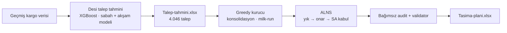

# TEKNOFEST 2026 · Lojistik Anahat Optimizasyonu — Final Aşaması

**Memlükler** takımının *TEKNOFEST 2026 Yapay Zekâ Destekli Lojistik Anahat
Optimizasyonu Yarışması* **Gelişmiş Çözüm (final) aşaması** çözümü.

Türkiye'deki 18 kargo transfer merkezi arasındaki bir haftalık yükü önce
**makine öğrenmesiyle tahmin eden**, ardından bu tahmini **toplam maliyeti
(araç + SLA cezası) en aza indirecek** şekilde araçlara, rotalara ve saatlere
dağıtan uçtan uca bir karar destek sistemi.

> İlk aşama (Temel İşlevli Çözüm / MVP — XGBoost + MIP):
> [TEKNOFEST-Yapay-Zeka-Destekli-Lojistik-Anahat-Optimizasyonu-Yarismasi](https://github.com/segemoglu/TEKNOFEST-Yapay-Zeka-Destekli-Lojistik-Anahat-Optimizasyonu-Yarismasi)

---

## Teslim edilen sonuç

| | |
|---|---|
| **Toplam maliyet** | **11.001.468,07 TL** |
| Araç maliyeti | 10.936.761,67 TL |
| SLA cezası | 64.706,40 TL (toplamın %0,59'u) |
| Planlanan talep | **4.046 / 4.046** |
| Taşınan yük | 5.418.736 desi |
| Fiziksel araç | 523 |
| Plan tarih aralığı | 29 Haziran – 7 Temmuz 2026 |

ALNS araması, greedy başlangıç planını **13.727.910 TL → 11.001.468 TL**'ye
indirdi: **%19,9** iyileşme.

Teslim dosyaları: [`Optimizasyon/TESLIM/`](Optimizasyon/TESLIM)

---

## Nasıl çalışıyor



### 1. Desi talep tahmini — [`Desi-Talep-Tahmini/`](Desi-Talep-Tahmini)

- **Sabah (09.00)** ve **akşam (17.00)** vardiyaları için birbirinden bağımsız
  iki **XGBoost** modeli
- Rota kimlikleri **Target Encoding** ile sayısallaştırılır; sızıntıyı önlemek
  için encoder yalnızca eğitim verisine fit edilir
- **TimeSeriesSplit + RandomizedSearchCV** ile hiperparametre araması
- 7 günlük tahmin **recursive** çalışır: her günün tahmini, ertesi günün hareketli
  ortalama ve standart sapma özelliklerine geri beslenir

| Model | MAE | RMSE | R² | WAPE |
|---|---|---|---|---|
| Akşam (17.00) | 598,9 desi | 1150,0 desi | 0,961 | %18,5 |
| Sabah (09.00) | 235,7 desi | 903,1 desi | 0,605 | %53,4 |

### 2. Araç ve rota optimizasyonu — [`Optimizasyon/`](Optimizasyon)

Kısıtlar: merkez başına günlük **elleçleme kapasitesi**, **tır ziyaret kotası**,
her gün sabit rotada çıkmak zorunda olan **14 zorunlu kiralık araç**, hat başına
1–2 günlük **SLA**.

1. **Greedy kurucu** — talepleri atomik parçalara böler, önce zorunlu kiralık
   araçları doldurur, aynı çıkışlı yükleri **20 durağa kadar milk-run**
   rotalarında birleştirir. Her adım yalnızca gerçek maliyeti düşürüyorsa kabul
   edilir.
2. **ALNS (Adaptive Large Neighborhood Search)** — 3 yıkım (random, worst, Shaw)
   ve 2 onarım (greedy, regret-2) operatörü, simulated annealing kabul kriteri.
   Sonuç rastgele tohuma göre yüz binlerce TL oynadığı için **4 tohum paralel**
   koşar ve en ucuz geçerli plan seçilir.
3. **Doğrulama** — her aday plan, maliyeti sıfırdan yeniden hesaplayan **bağımsız
   bir audit**ten ve tüm yarışma kısıtlarını denetleyen bir **validator**'dan
   geçer. Excel çıktısı geri okunup yeniden karşılaştırılır. Geçmeyen plan asla
   yazılmaz.

Ayrıntılı mimari: [`Optimizasyon/MIMARI.md`](Optimizasyon/MIMARI.md) ·
Kullanım: [`Optimizasyon/README.md`](Optimizasyon/README.md)

---

## Repo yapısı

```
├── Desi-Talep-Tahmini/
│   ├── Canliya_Alma_v2.ipynb     Eğitim + recursive tahmin (Google Colab)
│   ├── Master_Dataset_*.xlsx     Eğitim ve tahmin veri setleri
│   ├── 09.00_Sabah_Modeli/       Sabah modeli, encoder, test sonuçları, tahmin raporu
│   ├── 17.00_Aksam_Modeli/       Akşam modeli, encoder, test sonuçları, tahmin raporu
│   └── Talep-tahmini.xlsx        Birleştirilmiş teslim tahmini
│
└── Optimizasyon/
    ├── CALISTIR.bat              Tek tıkla plan üretimi (4 tohum paralel)
    ├── MIMARI.md                 Katmanlar, veri akışı, dosya dosya açıklama
    ├── TESLIM/                   Teslim edilen tahmin ve taşıma planı
    ├── src/                      domain · io · evaluation · planning · alns · forecasting
    ├── tests/                    237 birim testi
    ├── config/rules.yaml         Dosya/sütun eşlemesi ve kural yorumları
    ├── raw/current/              Yarışmanın sağladığı ham veriler
    └── data/interim/             Plan girdisi olan ML tahmini
```

## Çalıştırma

```bash
cd Optimizasyon
pip install -r requirements.txt
python -m src.planning.run_alns --iterations 1500 --time-limit 9000 --seed 123 --forecast data/interim/talep_tahmini_ml.xlsx
```

Windows'ta `Optimizasyon/CALISTIR.bat` dört tohumu paralel çalıştırıp en ucuz
planı seçer (~70 dakika).

Testler (237 test, ~4–8 dakika, `Optimizasyon/` klasöründe):

```bash
python -m unittest discover -s tests
```

## Teknolojiler

Python 3.11+ · pandas · openpyxl · XGBoost · scikit-learn · category_encoders ·
Google Colab · OR-Tools (opsiyonel CP-SAT rota birleştirme — denendi, kazanç
üretmediği için teslim koşusunda kapalı)
